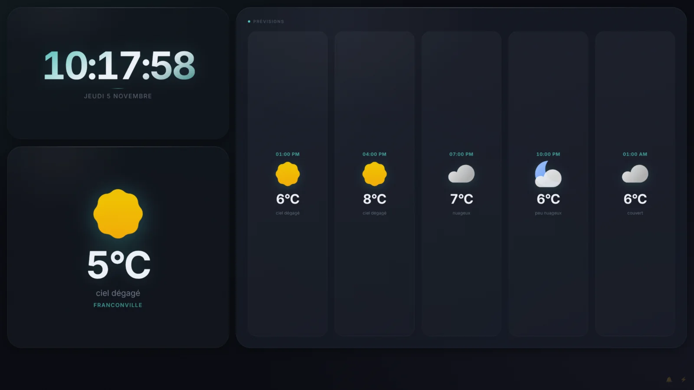
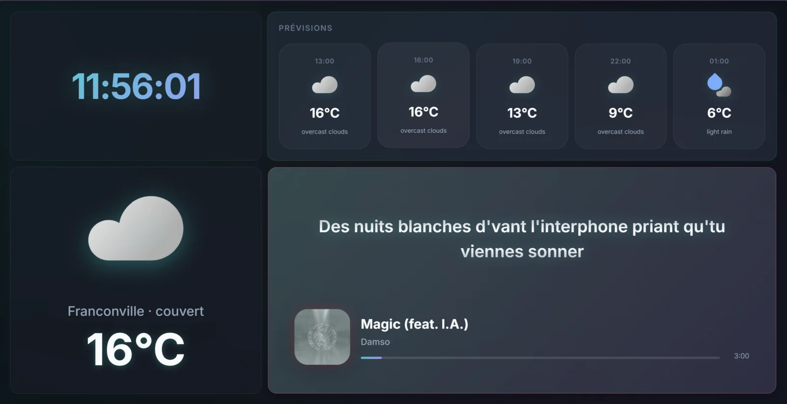
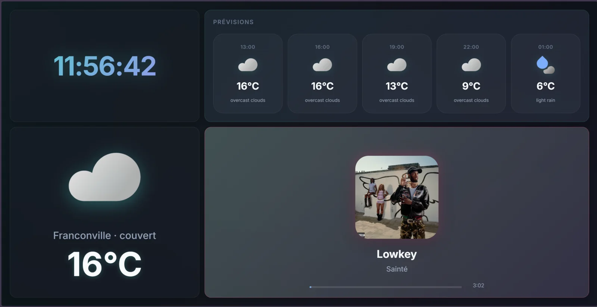
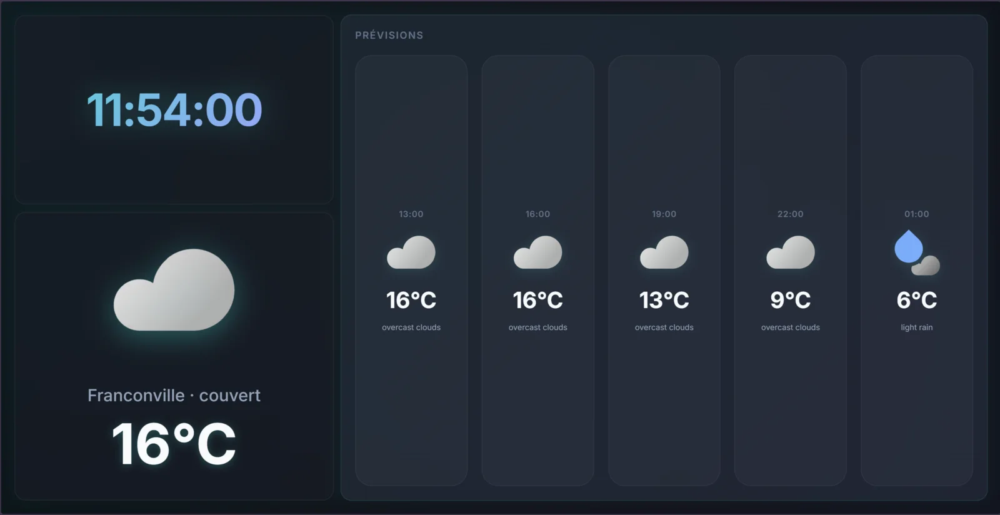

<div align="center">
  
</div>

# Tab Dashboard

Tableau de bord temps réel pensé pour un écran secondaire ou une tablette : horloge, météo et prévisions OpenWeather, lecteur musique avec pochette et paroles synchronisées, messages et notifications push, dans une interface glassmorphism animée.

## Captures

La première capture a été prise sur le projet lancé en local. Les trois suivantes sont les captures déjà présentes dans `docs/screenshots/`, recompressées en WebP.

<div align="center">
  
  
  <br />
  
  
</div>

## Fonctionnalités

- Horloge avec secondes et date en français.
- Météo actuelle et prévisions sur cinq créneaux, via OpenWeather et des icônes SVG locales.
- Carte musique : pochette, titre, artiste, progression et durée.
- Paroles synchronisées au format LRC, récupérées sur LRCLIB puis mises en cache sur disque pendant 30 jours.
- Mode plein écran automatique de la carte musique quand aucune parole n'est trouvée.
- Couleurs d'ambiance extraites de la pochette avec ColorThief.
- Messages envoyés depuis une page dédiée, affichés en surimpression sur l'écran et conservés dans un historique.
- Notifications push Web Push avec clés VAPID générées automatiquement au premier démarrage.
- Ajustement automatique de la qualité graphique selon les FPS mesurés, avec un bouton de forçage manuel.
- Mode PWA : manifeste, service worker, cache hors ligne et gestion des notifications.

## Stack

| Élément | Rôle |
| --- | --- |
| Node.js 18 ou plus | Exécution du serveur |
| Express 5 | Serveur HTTP et API REST |
| Socket.IO 4 | Diffusion temps réel vers l'écran |
| node-fetch 2 | Appels aux APIs externes |
| web-push 3 | Notifications push (VAPID) |
| dotenv | Chargement du fichier `.env` |
| JavaScript et CSS natifs | Interface dans `public/` |
| ColorThief (CDN cdnjs) | Extraction des couleurs de la pochette |

Le serveur utilise les APIs OpenWeather, LRCLIB, Deezer et Last.fm. Le cache local est stocké dans `cache/`, ignoré par Git.

## Prérequis

- Node.js 18 ou plus et npm.
- Une clé API OpenWeather pour la météo et les prévisions. Elle se crée sur [openweathermap.org/api](https://openweathermap.org/api) : créer un compte, générer une clé, puis la placer dans `.env`.
- Une clé API Last.fm est optionnelle. Elle sert de secours pour trouver une pochette si Deezer ne répond pas. Elle se crée sur [last.fm/api/account/create](https://www.last.fm/api/account/create).

Sans clé OpenWeather, le serveur démarre mais `/api/weather` et `/api/forecast` renvoient une erreur.

## Installation

```bash
git clone https://github.com/MattiaPARRINELLO/tab-dashboard.git
cd tab-dashboard
npm install
cp .env.example .env
# renseigner OPENWEATHER_API_KEY dans .env
npm start
```

Le serveur écoute sur `http://localhost:3000` par défaut. `package.json` ne définit que `npm start` (soit `node server.js`) et un script `test` qui échoue volontairement, faute de tests.

## Variables d'environnement

Toutes les variables sont lues dans `.env` par `dotenv`.

| Variable | Valeur par défaut | Rôle |
| --- | --- | --- |
| `PORT` | `3000` | Port HTTP du serveur |
| `OPENWEATHER_API_KEY` | aucune | Clé OpenWeather pour `/api/weather` et `/api/forecast` |
| `LASTFM_API_KEY` | aucune | Secours Last.fm pour la pochette d'un morceau |
| `VILLE` | `Franconville` | Ville utilisée par le géocodage OpenWeather |
| `VILLE_SHORT` | valeur de `VILLE` | Nom affiché sous la météo actuelle |
| `CORS_ORIGIN` | `https://youyou.mprnl.fr` | Origine autorisée en plus de `http://localhost` et `http://127.0.0.1` |

## Architecture

```text
Navigateur de l'écran
  |-- HTTP GET /api/weather, /api/forecast  --> Express --> OpenWeather
  |-- HTTP GET /api/lyrics                 --> Express --> LRCLIB (cache disque)
  |-- HTTP POST /api/message               --> Express --> cache/messages.json + Web Push
  |<-- Socket.IO events --------------------- Express <-- POST /api/music d'un client externe
                                                           |
                                                      Deezer, puis Last.fm
```

Le serveur `server.js` sert les pages statiques de `public/`, expose l'API REST et un serveur Socket.IO sur le même port.

- **Météo et prévisions** : `screen.html` appelle `/api/weather` au chargement puis toutes les 30 minutes, et `/api/forecast` toutes les 60 minutes. Le serveur garde les réponses en mémoire (10 minutes pour la météo, 30 minutes pour les prévisions) et met les coordonnées de la ville en cache 24 heures. Les icônes sont des fichiers SVG locaux dans `public/weather-icons/`.
- **Musique** : un client externe (par exemple une automatisation mobile) envoie `POST /api/music` avec titre, artiste, album, position et durée. Le serveur diffuse `musicData` en Socket.IO, cherche la pochette sur Deezer avec plusieurs requêtes, puis bascule sur Last.fm. La position est recalculée à la connexion d'un nouvel écran.
- **Paroles** : l'écran demande `/api/lyrics?track=...&artist=...`. Le module `services/lyricsCache.js` interroge LRCLIB, compacte le LRC, puis l'écrit en `.gz` dans `cache/lyrics/`. Une file d'attente limite les appels à LRCLIB. Les paroles déjà en cache sont resservies jusqu'à 30 jours.
- **Messages** : `POST /api/message` enregistre le texte, l'envoie à tous les écrans avec l'événement `popupMessage`, puis pousse une notification push. La fermeture du message est propagée par `dismissMessage`.
- **Notifications** : `/api/push/send` envoie une notification aux abonnements stockés dans `cache/subscriptions.json`. Les clés VAPID sont générées dans `cache/vapid-keys.json` au premier démarrage.
- **Session** : à la connexion Socket.IO, le serveur renvoie l'état musique courant, `musicStateEnded` si le morceau est terminé, et le message encore affiché.

### Pages

| Route | Contenu |
| --- | --- |
| `/` | Page de contrôle avec un formulaire de simulation musique |
| `/screen` | Tableau de bord principal |
| `/screen/low-end` | Même tableau de bord, pour un matériel moins puissant |
| `/music` | Vue musique seule, alimentée par Socket.IO |
| `/message` | Envoi d'un message à l'écran |
| `/notify` | Envoi d'une notification push |
| `/historique` | Historique des messages |
| `/cache` | Explorateur du cache de paroles |
| `/nolyrics` | Liste brute des morceaux sans paroles |

### API

| Méthode et route | Rôle |
| --- | --- |
| `GET /api/weather`, `GET /api/forecast` | Météo actuelle et prévisions |
| `POST /api/music` | Envoi de l'état musique |
| `GET /api/messages`, `POST /api/message` | Historique et envoi d'un message |
| `GET /api/lyrics` | Paroles synchronisées |
| `GET /api/lyrics-cache`, `GET /api/lyrics-cache/:file` | Cache de paroles |
| `GET /api/push/public-key`, `POST /api/push/subscribe`, `POST /api/push/unsubscribe`, `POST /api/push/send`, `GET /api/push/subscriptions/count` | Gestion des notifications push |
| `GET /api/debug/logs`, `POST /api/debug/log` | Journaux de débogage en mémoire |
| `POST /api/nolyrics/reset` | Remise à zéro de la liste des morceaux sans paroles |

## Mode PWA

- `manifest.json` déclare l'application en affichage `standalone`, en orientation paysage, avec le nom « Tab Dashboard ».
- Le service worker `public/sw.js` est enregistré par `screen.html`.
- Il précache `/message.html`, le manifeste et les icônes.
- Les pages HTML sont servies en réseau d'abord, les fichiers statiques en cache d'abord, et les appels `/api/` passent toujours par le réseau.
- Le service worker gère aussi l'événement `push` et ouvre `/screen` au clic sur une notification.

Le manifeste démarre directement sur `/screen`. Pour installer l'application, ouvrir `/screen` depuis `localhost` ou depuis une origine HTTPS, les notifications push exigeant un contexte sécurisé.

## Limites connues

- Aucun test automatisé, aucun lint et aucun workflow CI. `npm test` échoue volontairement.
- Les routes d'écriture (`/api/message`, `/api/push/send`, `/api/music`, `/api/nolyrics/reset`, `/api/debug/log`) ne demandent aucune authentification. À garder sur un réseau de confiance ou derrière un reverse proxy.
- Le serveur parle en HTTP simple. Les notifications push et le service worker exigent `localhost` ou HTTPS.
- La météo dépend d'une clé OpenWeather valide, les paroles de LRCLIB et les pochettes de Deezer ou Last.fm. Hors ligne, seuls la coquille statique et le cache du service worker restent disponibles.
- L'historique des messages conserve l'adresse IP de l'expéditeur.
- `cache/` contient les clés VAPID, les abonnements push et les données applicatives, dont la clé privée VAPID. Ce dossier est ignoré par Git et doit rester protégé.

## Licence

MIT, voir [LICENSE](LICENSE).

